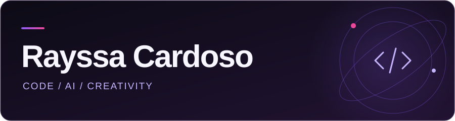
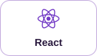
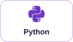
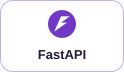
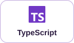
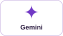
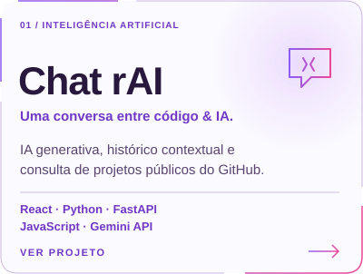
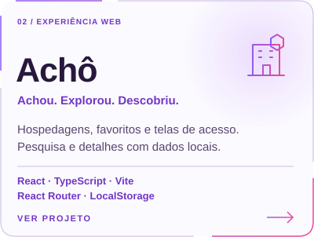
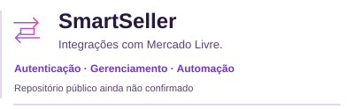
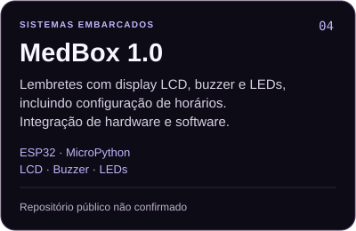

  <picture>
    <source media="(max-width: 600px)" srcset="assets/banner-mobile.svg" />
    
  </picture>
   
  
  
  

  <strong>Graduanda em Ciência da Computação · UNG</strong> 
  Experiência em suporte técnico e desenvolvimento de projetos. 
  Interfaces web &amp; APIs · Inteligência artificial &amp; automação · Git, branches &amp; Pull Requests

<h3 align="center">Meu toolkit, na prática</h3>

  
  
  
  
  
  

  
<strong>Além do toolkit</strong> · ferramentas, estudos e forma de trabalhar

**Formação:** Ciência da Computação na Universidade Guarulhos (UNG), em andamento.

Minha prática atual reúne React, JavaScript, Python, FastAPI e Gemini no Chat rAI, e React com TypeScript no Achô. Uso Git e GitHub com branches, commits e Pull Requests para organizar o desenvolvimento.

Exploro front-end, back-end, integração de APIs e automação. As ferramentas abaixo fazem parte de projetos e estudos em diferentes estágios de aprendizado, sem representar o mesmo nível de domínio:

- **Linguagens:** Python, JavaScript, TypeScript, SQL, HTML5 e CSS3.
- **Front-end:** React, Vite e Tailwind CSS.
- **Back-end e APIs:** FastAPI, Django e Node.js.
- **IA e automação:** Google Gemini, APIs de IA, n8n e ferramentas de automação.
- **Desenvolvimento:** Git, GitHub, VS Code e Vercel.
- **Outras explorações:** Power BI, Blender, Three.js, ESP32 e MicroPython.

<h3>Projetos que conectam ideias</h3>

  
  

  
Explorar os projetos · links e detalhes técnicos

**[Chat rAI / Portfólio](https://github.com/RayssaZsilva/Portfolio-rayssa):** integração entre front-end React/JavaScript, back-end Python/FastAPI e Gemini API. Conversação com IA generativa, histórico contextual e consulta de projetos públicos do GitHub.

**[Achô](https://github.com/RayssaZsilva/Acho):** aplicação de hospedagens com React, TypeScript e Vite. Pesquisa, detalhes, favoritos e telas de login e cadastro, com dados locais e persistência via LocalStorage.

<h4>Outros projetos &amp; explorações</h4>

  
  

  
   
  <a href="https://github.com/RayssaZsilva#year-list-container">Contribuições</a> · <a href="https://github.com/RayssaZsilva?tab=repositories">Repositórios &amp; linguagens</a> · Aprender. Construir. Compartilhar.

